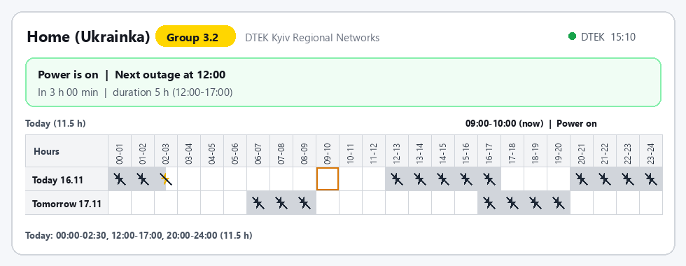

# UA Outages Card (`lovelace-ua-outages-card`)

[](https://github.com/shed-crypto/lovelace-ua-outages-card/actions/workflows/ci.yml)
[](https://github.com/shed-crypto/lovelace-ua-outages-card/actions/workflows/validate.yml)
[](https://github.com/shed-crypto/lovelace-ua-outages-card/releases)
[](https://www.typescriptlang.org/)
[](https://lit.dev/)
[](https://hacs.xyz/)
[](LICENSE)

Custom Home Assistant Lovelace cards for visualizing Ukrainian electricity outage schedules from [`ha-ua-outages`](https://github.com/shed-crypto/ha-ua-outages) (`ua_outages` integration) as well as third-party sensors exposing 48-slot schedules or outage interval attributes.

Includes two cards in a single lightweight bundle (`dist/ua-outages-card.js`):

1. **`custom:ua-outages-card`** — daily operational card (today & tomorrow schedule, live local countdown, progress bar, address outage banner, and optional battery indicator).
2. **`custom:ua-outages-weekly-card`** — 7x24 weekly schedule matrix in DTEK table style with today's row highlighted.




## Features

- **Zero-YAML device auto-discovery:** select any single entity from a `ua_outages` device in the visual editor (`entity`) and all companion entities (`_outages_tomorrow`, `_group`, `_next_outage`, `_outage_end`, `_scheduled_outage`, `_address_status`, `_restoration`, `_connection`, `calendar.*_outages`) are resolved automatically via `device_id`.
- **Three visual styles for the daily card:**
  - `dtek` — official DTEK-style table with `00-01`..`23-24` columns, crossed-lightning icons, and half-hour (`:30`) cell splits.
  - `modern` — 24 distinct labeled hour tiles (`2x12` or `1x24` grid) with color-coded slots and live `"now"` half-hour marker.
  - `timeline` — continuous 24h colored bar (`00..23`) with a live vertical `"now"` needle positioned to the exact minute and merged outage interval chips below.
- **Unified Today / Week view modes (`view_mode`):** choose `daily_only`, `switchable` (adds an instant header tab toggle between Today and Week inside a single card), or `both` (stacked daily and weekly blocks).
- **Five built-in color themes (`theme`):** `auto` (Home Assistant light/dark), `dtek_light`, `dtek_dark`, `kiosk_dark` (high-contrast emerald/crimson/amber wall kiosk palette), and `oled_black`.
- **Three layouts (`full` | `compact` | `kiosk`) & granular visibility controls:** independently toggle header, group pill (auto-deduplicated from title), region subtitle, connection badge, live countdown, yellow `"now"` cursor line, tomorrow row, interval chips/text, and legend.
- **Optional battery & reserve status (`battery_soc_entity`, `battery_runtime_entity`, `battery_low_threshold`):** completely omitted unless configured; when enabled, shows battery `%`, remaining backup duration, and whether reserve covers the next outage.
- **Responsive weekly card (`custom:ua-outages-weekly-card` & integrated week tab):** supports `auto` (CSS container query switching seamlessly to mobile-friendly list or compact bars below 460px), `timeline_bars` (7x24 continuous color bars with a shared live `"now"` cursor line), `table` (classic 7x24 DTEK grid), and `list`, plus `empty_days_mode` (`compact_empty` | `hide_unscheduled` | `show_all`), `mon_sun` / `rolling` order, and automatic notice when DTEK disables the weekly plan.
- **Multi-language UI (`auto` | `uk` | `en` | `ru`)** and local browser countdown updates (zero polling load on Home Assistant).

## Installation

### HACS (Custom Repository)

1. Open **HACS** -> **Frontend** -> **Custom repositories**.
2. Add `https://github.com/shed-crypto/lovelace-ua-outages-card` with category **Dashboard** (Plugin).
3. Install **UA Outages Card** and reload your browser resources when prompted.
4. Add **UA Outages Card** or **UA Outages Weekly Card** from the Lovelace card picker.

### Manual Installation

1. Download `ua-outages-card.js` from the latest GitHub Release (or copy `dist/ua-outages-card.js`).
2. Place it in `<config>/www/ua-outages-card.js`.
3. Under **Settings** -> **Dashboards** -> **Resources**, add `/local/ua-outages-card.js` as a **JavaScript Module**.

## Configuration

Both cards provide full visual UI editors (`getConfigElement()`) so YAML editing is optional.

### Daily Card (`custom:ua-outages-card`)

```yaml
type: custom:ua-outages-card
entity: sensor.home_outages_today
title: Home (Ukrainka)
style: timeline # dtek | modern | timeline
theme: kiosk_dark # auto | dtek_light | dtek_dark | kiosk_dark | oled_black
layout: full # full | compact | kiosk
view_mode: switchable # daily_only | switchable | both
default_view: today # today | week (when view_mode is switchable)
interval_display: auto # auto | chips | text | both | none
modern_grid: 2x12 # 2x12 | 1x24 (when style is modern)
weekly_view: auto # auto | timeline_bars | table | list
mobile_weekly_view: list # list | compact_bars (when weekly_view is auto)
empty_days_mode: auto # auto | compact_empty | hide_unscheduled | show_all
row_order: mon_sun # mon_sun | rolling
language: auto # auto | uk | en | ru
show_header: true
show_title: true # or set title: "" to hide card title while keeping badge/status
show_group_badge: true
show_region: true
show_connection: true
show_countdown: true
show_address_alert: true
show_readout: true
show_now_line: true
show_today: true
show_tomorrow: true
show_possible: true # set false to filter out grey-zone/possible blocks on this card only
show_intervals_text: true
show_legend: true
# Optional battery/inverter sensors (hidden when omitted):
# battery_soc_entity: sensor.inverter_battery_soc
# battery_runtime_entity: sensor.inverter_battery_runtime
# battery_low_threshold: 20
```

Manual entity overrides (`calendar_entity`, `tomorrow_entity`, `group_entity`, `next_outage_entity`, `outage_end_entity`, `scheduled_outage_entity`, `address_status_entity`, `restoration_entity`, `connection_entity`, `schedule_updated_entity`, `last_update_entity`) are supported in the editor's **Manual entity overrides** section or YAML for third-party sensors.

### Weekly Card (`custom:ua-outages-weekly-card`)

```yaml
type: custom:ua-outages-weekly-card
entity: calendar.home_outages
title: Weekly Schedule
theme: auto # auto | dtek_light | dtek_dark | kiosk_dark | oled_black
layout: full # full | compact | kiosk
weekly_view: auto # auto | timeline_bars | table | list
mobile_weekly_view: list # list | compact_bars
empty_days_mode: auto # auto | compact_empty | hide_unscheduled | show_all
row_order: mon_sun # mon_sun | rolling
language: auto # auto | uk | en | ru
show_header: true
show_title: true # or set title: "" to hide card title while keeping badge/status
show_group_badge: true
show_readout: true
show_now_line: true
show_possible: true # set false to hide grey-zone/possible calendar forecasts on this card
show_intervals_text: true
show_legend: true
```

> Tip: When DTEK disables the weekly plan table (`weekly_schedule_shown: false`), future unscheduled days have no grey-zone forecast by default unless you enable `force_weekly_preset` in the `ua_outages` integration options.

## Development

```bash
npm ci
npm run typecheck
npm run lint
npm run format:check
npm run test:coverage
npm run build
```

## License

[MIT](LICENSE) 2026 Rachenko Oleksii

