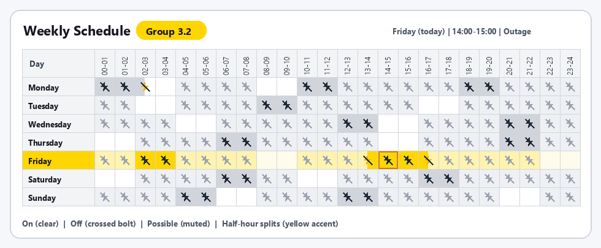

# UA Outages Card (`lovelace-ua-outages-card`)

Custom Home Assistant Lovelace cards for visualizing Ukrainian electricity outage schedules from [`ha-ua-outages`](https://github.com/shed-crypto/ha-ua-outages) (`ua_outages` integration) as well as third-party sensors exposing 48-slot schedules or outage interval attributes.

Includes two cards in a single lightweight bundle (`dist/ua-outages-card.js`):

1. **`custom:ua-outages-card`** — daily operational card (today & tomorrow schedule, live local countdown, progress bar, address outage banner, and optional battery indicator).
2. **`custom:ua-outages-weekly-card`** — 7x24 weekly schedule matrix in DTEK table style with today's row highlighted.




## Features

- **Zero-YAML device auto-discovery:** select any single entity from a `ua_outages` device in the visual editor (`entity`) and all companion entities (`_outages_tomorrow`, `_group`, `_next_outage`, `_outage_end`, `_scheduled_outage`, `_address_status`, `_restoration`, `_connection`, `calendar.*_outages`) are resolved automatically via `device_id`.
- **Two visual styles for the daily card:**
  - `dtek` — official DTEK-style table with `00-01`..`23-24` columns, crossed-lightning icons, and half-hour (`:30`) cell splits.
  - `modern` — 24 distinct labeled hour tiles (`2x12` or `1x24` grid) with color-coded slots and live `"now"` half-hour marker.
- **Selectable color themes (`auto` | `dtek_light` | `dtek_dark`):** follows your Home Assistant light/dark theme by default or switches to dedicated DTEK Light / DTEK Dark palettes.
- **Three layouts (`full` | `compact` | `kiosk`):** fits main dashboards, narrow mobile columns, and wall tablets.
- **Optional battery badge (`battery_soc_entity`):** omitted completely unless configured, so users without inverters or batteries see a clean card without extra clutter.
- **Standalone weekly 7x24 card:** supports `mon_sun` (Monday–Sunday with yellow today highlight) and `rolling` (next 7 days starting today), reading factual today/tomorrow schedules plus calendar forecasts with client-side caching.
- **Multi-language UI (`auto` | `uk` | `en` | `ru`)** and local browser countdown updates (zero polling load on Home Assistant).

## Installation

### HACS (Custom Repository)

1. Open **HACS** -> **Frontend** -> **Custom repositories**.
2. Add `https://github.com/shed-crypto/lovelace-ua-outages-card` with category **Dashboard** (Plugin).
3. Install **UA Outages Card** and reload your browser resources when prompted.
4. Add **UA Outages Card** or **UA Outages Weekly Card** from the Lovelace card picker.

### Manual Installation

1. Download `ua-outages-card.js` from the latest GitHub Release (or copy `dist/ua-outages-card.js`).
2. Place it in `<config>/www/ua-outages-card.js`.
3. Under **Settings** -> **Dashboards** -> **Resources**, add `/local/ua-outages-card.js` as a **JavaScript Module**.

## Configuration

Both cards provide full visual UI editors (`getConfigElement()`) so YAML editing is optional.

### Daily Card (`custom:ua-outages-card`)

```yaml
type: custom:ua-outages-card
entity: sensor.home_outages_today
title: Home (Ukrainka)
style: dtek # dtek | modern
theme: auto # auto | dtek_light | dtek_dark
layout: full # full | compact | kiosk
modern_grid: 2x12 # 2x12 | 1x24 (used when style is modern)
language: auto # auto | uk | en | ru
show_header: true
show_countdown: true
show_tomorrow: true
show_intervals_text: true
show_legend: true
# Optional battery SOC entity (hidden when omitted):
# battery_soc_entity: sensor.inverter_battery_soc
```

Manual entity overrides (`tomorrow_entity`, `group_entity`, `next_outage_entity`, `outage_end_entity`, `scheduled_outage_entity`, `address_status_entity`, `restoration_entity`, `connection_entity`, `schedule_updated_entity`, `last_update_entity`) are supported in the editor's **Manual entity overrides** section or YAML for third-party sensors.

### Weekly Card (`custom:ua-outages-weekly-card`)

```yaml
type: custom:ua-outages-weekly-card
entity: calendar.home_outages
title: Weekly Schedule
theme: auto # auto | dtek_light | dtek_dark
row_order: mon_sun # mon_sun | rolling
language: auto # auto | uk | en | ru
show_legend: true
```

## Development

```bash
npm ci
npm run typecheck
npm run lint
npm run format:check
npm run test:coverage
npm run build
```

## License

[MIT](LICENSE) 2026 Rachenko Oleksii

